# AppRoomProduto: Cadastro de Produtos com Room SQLite

**Aluno(a):** Seu Nome Completo
**RA:** 000000
**Disciplina:** Programação para Dispositivos Móveis
**Professor(a):** Nome do Professor

## Sobre o projeto
Aplicativo Android em Kotlin que cadastra, lista, busca, atualiza e exclui produtos usando persistência local com Room (SQLite). Os dados ficam salvos no próprio celular e continuam lá mesmo depois de fechar o app.

## Tecnologias
- Kotlin 1.9.0
- Room 2.6.1 (SQLite) com `kapt`
- ViewBinding
- Corrotinas (`lifecycleScope` + funções `suspend`)
- RecyclerView + `ListAdapter` / `DiffUtil`
- Material Components 3
- Android Gradle Plugin 8.5.1 · Gradle 8.7 · compileSdk 34 · minSdk 24
- Desenvolvido no Android Studio Koala (2024.1.1)

## Estrutura
```
app/src/main/
├── java/br/universidade/approomproduto/
│   ├── model/Product.kt        ← tabela (Entidade)
│   ├── dao/ProductDao.kt       ← comandos SQL (DAO)
│   ├── db/AppDatabase.kt       ← o banco de dados (Singleton)
│   └── view/
│       ├── MainActivity.kt     ← a tela
│       └── ProductAdapter.kt   ← adapter da RecyclerView
├── res/layout/activity_main.xml
├── res/layout/item_product.xml
└── AndroidManifest.xml
```

## Prints do app
| Tela inicial | Lista após fechar e reabrir o app (persistência) |
|---|---|
| 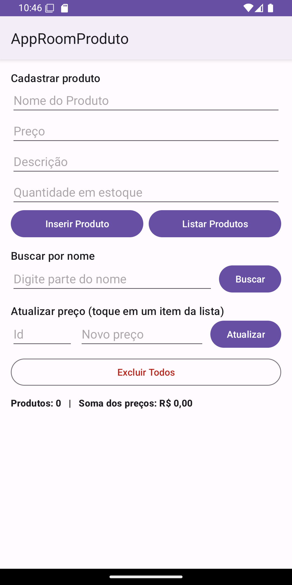 |  |

### Logcat com a listagem (filtro `tag:TAG`)
```
I TAG : Produto inserido: Teclado - R$149.9
I TAG : Produto inserido: Mouse - R$59.0
I TAG : Produto inserido: Monitor - R$899.9
I TAG : Produto = Teclado, Preço = R$149.9, Descrição = Teclado USB, Qtd = 10
I TAG : Produto = Mouse, Preço = R$59.0, Descrição = Mouse optico, Qtd = 25
I TAG : Produto = Monitor, Preço = R$899.9, Descrição = Monitor 24 polegadas, Qtd = 5
I TAG : Busca por "mo": 2 produto(s)
I TAG : Produto atualizado: #2 Mouse - R$59.0 -> R$49.9
I TAG : Produto excluído: #3 Monitor
I TAG : Todos os produtos foram excluídos.
I TAG : Nenhum produto encontrado.
```

---

## Parte A: Complemento prático

### A1. Limpar campos após inserir
**O que foi feito:** depois que o `insertAll` termina com sucesso (dentro da corrotina), a função `limparCampos()` apaga o conteúdo dos campos Nome, Preço, Descrição e Quantidade e chama `requestFocus()` no campo Nome, deixando o cursor pronto para o próximo cadastro.

```kotlin
lifecycleScope.launch {
    productDao.insertAll(product)
    Toast.makeText(this@MainActivity, "Produto inserido!", Toast.LENGTH_SHORT).show()
    limparCampos()
    listarProdutos()
}

private fun limparCampos() {
    binding.editProductName.text.clear()
    binding.editProductPrice.text.clear()
    binding.editProductDescription.text.clear()
    binding.editProductQuantity.text.clear()
    binding.editProductName.requestFocus()
}
```
Print (campos limpos, cursor no Nome e o Toast "Produto inserido!"):

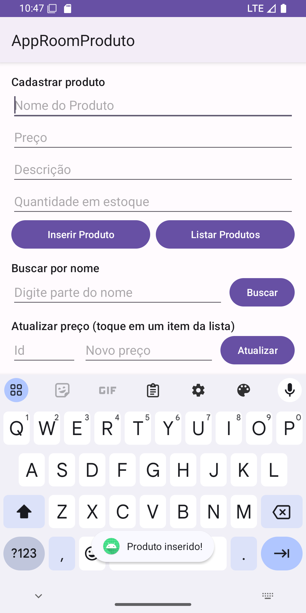

### A2. Validação de preço
**O que foi feito:** o texto do preço é convertido com `toDoubleOrNull()`. Se o resultado for `null` (campo vazio ou inválido), zero ou negativo, o produto não é salvo e o erro aparece no próprio campo com `editProductPrice.error`. Também validei o nome (obrigatório) e a quantidade (não pode ser negativa).

```kotlin
val price = priceText.toDoubleOrNull()
if (price == null || price <= 0) {
    binding.editProductPrice.error = "Informe um preço válido"
    binding.editProductPrice.requestFocus()
    return
}
```
Print (tentando salvar com preço 0):

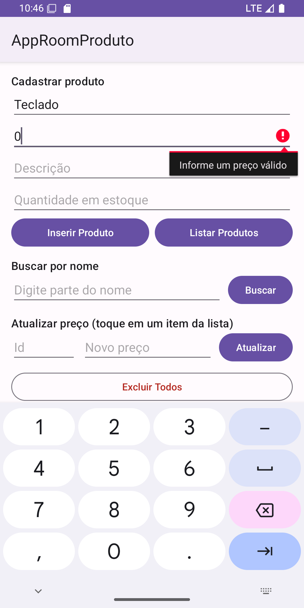

### A3. Lista na tela (desafio extra: RecyclerView)
**O que foi feito:** em vez de mostrar só no Logcat, adicionei uma `RecyclerView` abaixo dos botões. Cada produto vira um card (`item_product.xml`) com id, nome, preço formatado em reais, quantidade e descrição. O `ProductAdapter` é um `ListAdapter` com `DiffUtil`, então basta chamar `submitList()` com a lista vinda do banco. O Logcat continua sendo usado também.

```kotlin
// MainActivity
adapter = ProductAdapter(
    onItemClick = { product -> preencherAtualizacao(product) },
    onDeleteClick = { product -> excluirProduto(product) }
)
binding.recyclerProducts.layoutManager = LinearLayoutManager(this)
binding.recyclerProducts.adapter = adapter

// ProductAdapter.onBindViewHolder
textName.text = "#${product.id}  ${product.name}"
textDetails.text = "${product.price.toReais()}  ·  Qtd: ${product.quantity}"
textDescription.text = product.description
```

### A4. Total do estoque
**O que foi feito:** junto da lista, um `TextView` mostra quantos produtos estão cadastrados (`products.size`) e a soma dos preços (`products.sumOf { it.price }`), formatada como moeda brasileira. O total é atualizado toda vez que a lista muda (listar, buscar, inserir, atualizar ou excluir).

```kotlin
private fun mostrarProdutos(products: List<Product>) {
    adapter.submitList(products)
    binding.textEmpty.isVisible = products.isEmpty()
    val total = products.sumOf { it.price }
    binding.textTotal.text = "Produtos: ${products.size}   |   Soma dos preços: ${total.toReais()}"
}
```
Print de A3 + A4 (3 produtos, soma R$ 149,90 + R$ 59,00 + R$ 899,90 = R$ 1.108,80):

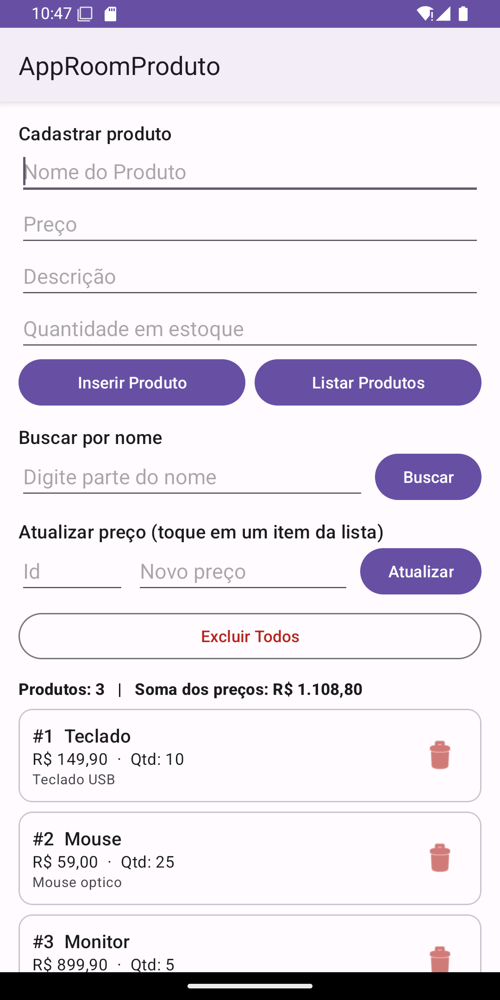

### A5. Buscar por nome
**O que foi feito:** criei a função `buscarPorNome` no DAO com `LIKE` e, na tela, um campo de busca com o botão Buscar. O texto digitado é envolvido por `%` (`"%$texto%"`) para encontrar qualquer nome que **contenha** o trecho. Se o campo estiver vazio, a lista completa é mostrada.

```kotlin
// ProductDao
@Query("SELECT * FROM product WHERE name LIKE :nome")
suspend fun buscarPorNome(nome: String): List<Product>

// MainActivity
lifecycleScope.launch {
    val products = productDao.buscarPorNome("%$texto%")
    mostrarProdutos(products)
}
```
Print (busca por "mo" encontrou Mouse e Monitor; o `LIKE` do SQLite não diferencia maiúsculas/minúsculas):

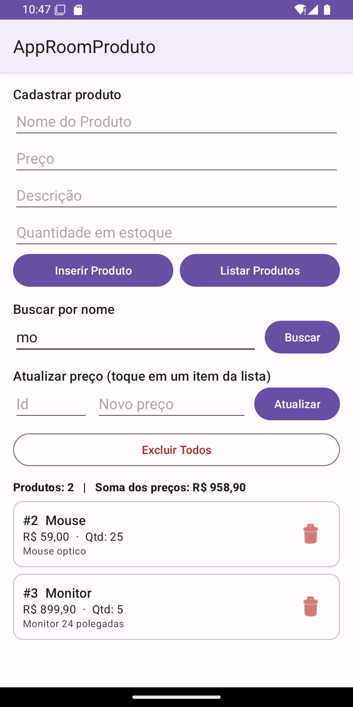

### A6. Excluir produtos (+ desafio extra com `@Delete`)
**O que foi feito:** o DAO ganhou `deleteAll()` com `DELETE FROM product`, ligado ao botão **Excluir Todos**, que antes pede confirmação num `AlertDialog` (para não apagar tudo sem querer). No desafio extra, cada card tem um ícone de lixeira que exclui só aquele produto usando `@Delete` (o Room usa a chave primária `id` do objeto para saber qual linha apagar).

```kotlin
// ProductDao
@Delete
suspend fun delete(product: Product)

@Query("DELETE FROM product")
suspend fun deleteAll()

// MainActivity
private fun excluirProduto(product: Product) {
    lifecycleScope.launch {
        productDao.delete(product)
        listarProdutos()
    }
}
```
| Excluindo só o Monitor (lixeira) | Confirmação | Depois de Excluir Todos |
|---|---|---|
| 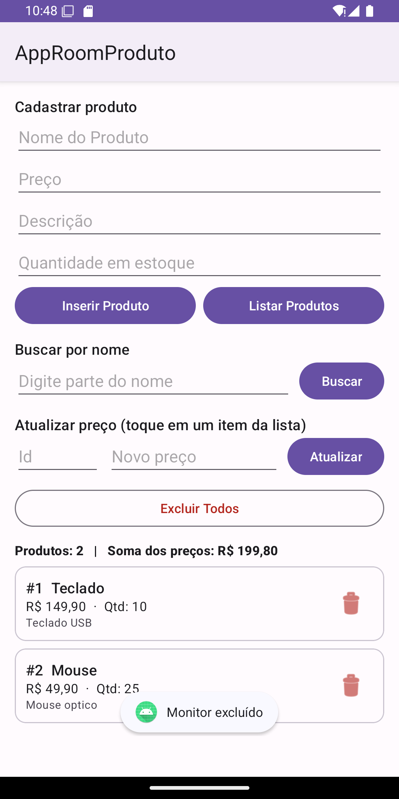 | 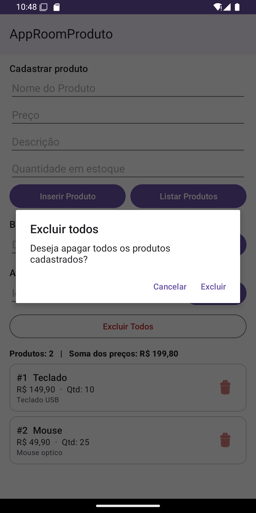 | 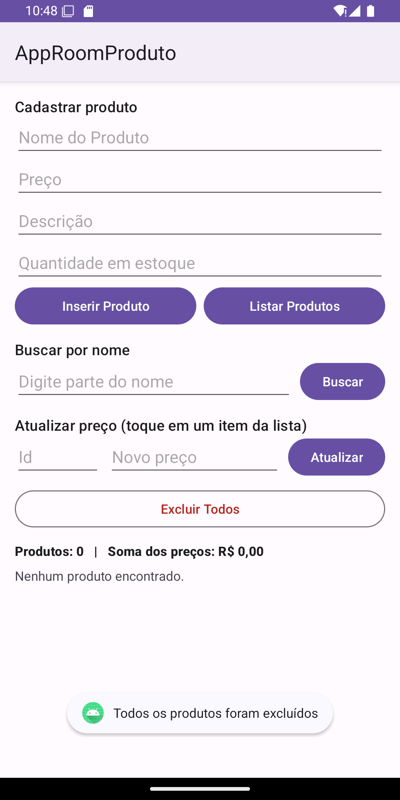 |

### A7. Atualizar produto
**O que foi feito:** criei a função `update` com `@Update` no DAO. Na tela, o usuário informa o **id** e o **novo preço** (ou simplesmente toca em um produto da lista, que já preenche esses dois campos). O app busca o produto com `getById`, cria uma cópia com o novo preço usando `copy(price = ...)` e chama `update`. O Room encontra a linha pelo `id` e atualiza.

```kotlin
// ProductDao
@Query("SELECT * FROM product WHERE id = :id")
suspend fun getById(id: Int): Product?

@Update
suspend fun update(product: Product): Int

// MainActivity
lifecycleScope.launch {
    val product = productDao.getById(id)
    if (product == null) {
        binding.editUpdateId.error = "Produto não encontrado"
        return@launch
    }
    productDao.update(product.copy(price = newPrice))
    listarProdutos()
}
```
| Antes (Mouse a R$ 59,00, id 2 selecionado) | Depois (Mouse a R$ 49,90) |
|---|---|
| 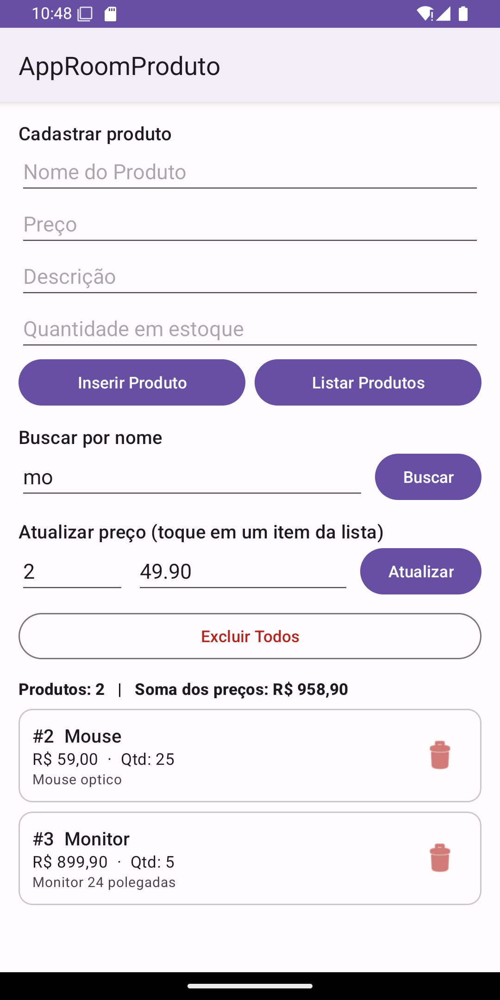 | 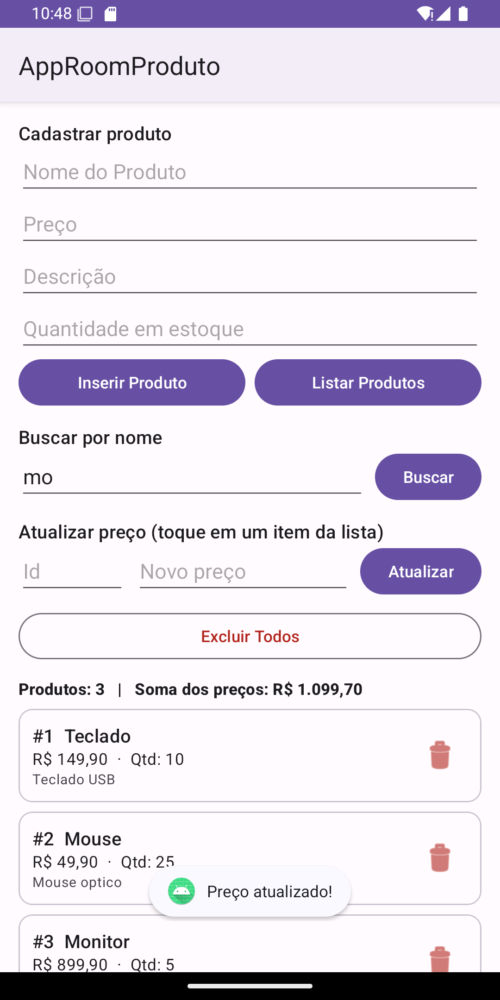 |

### A8. Novo campo na tabela (`quantity`) e versão 2 do banco
**O que foi feito:** adicionei `quantity: Int` na entidade `Product`, um campo "Quantidade em estoque" no layout e aumentei a versão do banco de `1` para `2` no `@Database`.

```kotlin
@Entity
data class Product(
    @PrimaryKey(autoGenerate = true) val id: Int = 0,
    @ColumnInfo(name = "name") val name: String,
    @ColumnInfo(name = "price") val price: Double,
    @ColumnInfo(name = "description") val description: String?,
    @ColumnInfo(name = "quantity") val quantity: Int = 0
)

@Database(entities = [Product::class], version = 2, exportSchema = false)
abstract class AppDatabase : RoomDatabase() { ... }
```

**O que aconteceu com os produtos já cadastrados:** eles foram **apagados**. Testei assim: deixei no emulador um banco na versão 1 (tabela `product` sem a coluna `quantity`) com dois produtos e depois abri o app na versão 2:

```
-- banco antes (versão 1)
user_version = 1
id|name|price|description
1|Teclado|149.9|Teclado USB
2|Mouse|59.0|Mouse optico

-- banco depois de abrir o app versão 2
user_version = 2
colunas: id, name, price, description, quantity
total de produtos = 0
```

**Por quê:** quando o Room abre o banco, ele compara a versão gravada no arquivo (1) com a versão declarada no código (2). Como a estrutura mudou, ele precisa de uma *Migration* que diga como sair da versão 1 e chegar à 2 (por exemplo, `ALTER TABLE product ADD COLUMN quantity INTEGER NOT NULL DEFAULT 0`). Eu não escrevi essa migração, e o banco foi criado com `.fallbackToDestructiveMigration()`. Com essa opção, quando falta a migração, o Room **apaga todas as tabelas e cria tudo de novo** com a estrutura nova, então os dados antigos se perdem. Sem o `fallbackToDestructiveMigration()`, o app fecharia com um erro do tipo `IllegalStateException: A migration from 1 to 2 was required but not found`.

| Campo Quantidade no formulário | Lista vazia depois da migração destrutiva |
|---|---|
| 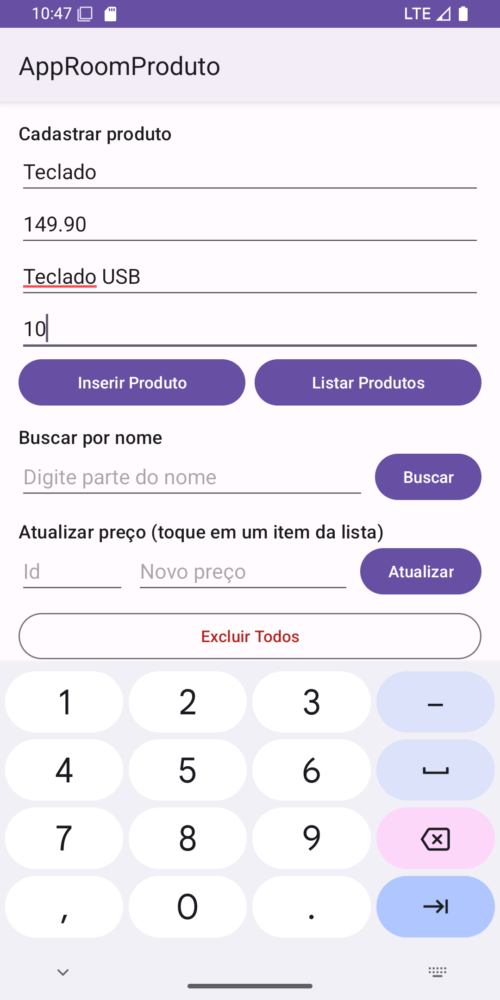 | 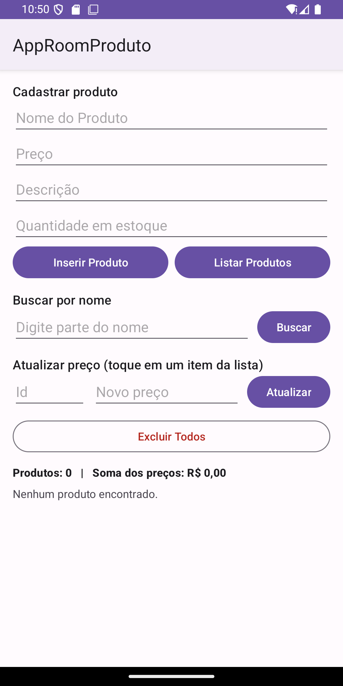 |

---

## Parte B: Questões dissertativas

### B1. O que é persistência de dados? O que aconteceria se os produtos fossem guardados apenas em uma `MutableList` dentro da `MainActivity`?
**Resposta:** Persistência de dados é a capacidade de guardar informações de forma que elas sobrevivam ao fim do processo que as criou, ou seja, os dados continuam existindo depois que o app é fechado, o celular é reiniciado ou o sistema mata o processo para liberar memória. No meu projeto isso é feito pelo Room, que grava os produtos em um arquivo SQLite (`database-name`) dentro da pasta privada do app. Se os produtos ficassem só numa `MutableList` dentro da `MainActivity`, eles existiriam apenas na memória RAM enquanto aquela instância da Activity estivesse viva. Bastaria fechar o app, o Android encerrar o processo em segundo plano ou até girar a tela (que recria a Activity) para a lista ser perdida e o usuário ter que cadastrar tudo de novo. Testei isso na prática: depois de cadastrar três produtos, forcei o fechamento do app, abri de novo, cliquei em Listar e os produtos continuavam lá (print "persistência" acima), o que não aconteceria com uma lista em memória.

### B2. Qual a diferença entre usar o SQLite diretamente (`SQLiteOpenHelper` + SQL manual) e usar o Room? Cite pelo menos duas vantagens do Room.
**Resposta:** Com o `SQLiteOpenHelper`, o programador escreve à mão o `CREATE TABLE`, os `INSERT`, `UPDATE` e `SELECT`, e depois precisa percorrer um `Cursor` coluna por coluna para montar os objetos Kotlin, o que gera muito código repetitivo e fácil de errar. O Room é uma camada por cima do mesmo SQLite que gera esse código automaticamente a partir de anotações. Vantagens: (1) **verificação do SQL em tempo de compilação**: se eu escrever `SELECT * FROM produto` em vez de `product` no `ProductDao`, o build falha na hora, em vez de o app quebrar só quando o usuário clicar no botão; (2) **mapeamento automático** entre linhas da tabela e objetos: `getAll()` já devolve uma `List<Product>`, sem mexer com `Cursor`; (3) **menos código**: `@Insert`, `@Update` e `@Delete` não precisam de SQL nenhum; (4) **integração com corrotinas** (`suspend`) e proteção contra acesso na main thread; (5) suporte organizado a **migrações** de versão do banco.

### B3. Explique o papel de cada uma das três peças do Room: Entity, DAO e Database. Como elas se relacionam no seu projeto?
**Resposta:** A **Entity** (`model/Product.kt`, anotada com `@Entity`) descreve a tabela: cada propriedade da data class vira uma coluna (`id`, `name`, `price`, `description`, `quantity`) e `@PrimaryKey(autoGenerate = true)` define a chave primária gerada pelo banco. O **DAO** (`dao/ProductDao.kt`, `@Dao`) é a interface com as operações permitidas sobre essa tabela: `getAll`, `getById`, `buscarPorNome`, `insertAll`, `update`, `delete` e `deleteAll`. Eu só escrevo a assinatura e o Room gera a implementação. O **Database** (`db/AppDatabase.kt`, `@Database`) junta tudo: declara quais entidades existem (`entities = [Product::class]`), a versão do esquema (2) e expõe o DAO por `abstract fun productDao()`. A relação no projeto é: a `MainActivity` pede a instância do `AppDatabase`, pega dele o `ProductDao` e chama os métodos do DAO passando e recebendo objetos `Product`. A tela nunca escreve SQL e nunca fala direto com o SQLite.

### B4. Por que o Android não permite acessar o banco na thread principal? O que é um ANR? Como `suspend` e `lifecycleScope.launch` resolvem isso?
**Resposta:** A thread principal (UI thread) é a responsável por desenhar a tela e responder a toques. Acessar o banco envolve ler e escrever em disco, o que pode demorar de milissegundos a segundos dependendo do volume de dados e do aparelho. Se isso acontecer na UI thread, a tela congela enquanto a operação não termina. Por isso o Room, por padrão, lança `Cannot access database on the main thread`. O **ANR (Application Not Responding)** é a janela que o Android mostra quando a thread principal fica bloqueada por muito tempo (cerca de 5 segundos sem responder a um toque), oferecendo ao usuário a opção de fechar o app. No meu projeto, todas as funções do `ProductDao` são `suspend`, e para funções `suspend` o Room executa a consulta em uma thread de segundo plano própria. Na `MainActivity`, eu chamo essas funções dentro de `lifecycleScope.launch { ... }`, que cria uma corrotina: ela "pausa" enquanto o banco trabalha, sem travar a tela, e depois continua na thread principal, onde posso atualizar a RecyclerView e mostrar o Toast com segurança. Além disso, o `lifecycleScope` cancela a corrotina automaticamente se a Activity for destruída, evitando vazamentos.

### B5. O que faz o `fallbackToDestructiveMigration()`? Por que ele é perigoso em um app publicado na Play Store? O que seria uma migração (Migration)?
**Resposta:** O `fallbackToDestructiveMigration()` diz ao Room: "se a versão do banco mudou e você não encontrar uma migração para isso, apague o banco e crie de novo do zero". Durante o desenvolvimento é prático, porque eu mudo a entidade e não preciso me preocupar com os dados de teste. Foi exatamente o que aconteceu no item A8: ao passar da versão 1 para a 2, os produtos cadastrados foram apagados. Em um app publicado isso é perigoso porque, quando o usuário atualizar o app pela Play Store, ele perderia **todos os dados** que tinha (cadastros, histórico, configurações) sem aviso, o que é uma péssima experiência e pode até causar prejuízo real. Uma **Migration** é um objeto que ensina o Room a transformar o banco de uma versão para outra preservando os dados, normalmente com comandos SQL. Para o meu caso seria:
```kotlin
val MIGRATION_1_2 = object : Migration(1, 2) {
    override fun migrate(db: SupportSQLiteDatabase) {
        db.execSQL("ALTER TABLE product ADD COLUMN quantity INTEGER NOT NULL DEFAULT 0")
    }
}
// Room.databaseBuilder(...).addMigrations(MIGRATION_1_2).build()
```
Assim os produtos antigos continuariam lá, apenas com a quantidade 0.

### B6. Qual é a vantagem do ViewBinding em relação ao `findViewById`? Que tipo de erro ele ajuda a evitar?
**Resposta:** Com `viewBinding = true` no `build.gradle.kts`, o Android gera para cada layout uma classe (por exemplo `ActivityMainBinding` e `ItemProductBinding`) com uma propriedade para cada view que tem `id`. No meu código eu acesso `binding.editProductPrice` ou `binding.recyclerProducts` diretamente, já com o tipo certo. Com `findViewById` eu teria que escrever `findViewById<EditText>(R.id.editProductPrice)` para cada componente, repetindo código e informando o tipo na mão. O ViewBinding evita principalmente dois erros: o **`NullPointerException`**, que acontece quando se usa um id que não existe naquele layout (por exemplo, um id de outra tela), e o **`ClassCastException`**, quando se faz o cast para o tipo errado (tratar um `Button` como `TextView`, por exemplo). Como a classe de binding é gerada a partir do XML, esses erros aparecem em tempo de compilação e não com o app rodando. Também deixa o código mais limpo e mais rápido de escrever.

### B7. Por que em apps maiores é recomendado criar o banco como Singleton? O que poderia acontecer se várias telas criassem cada uma o seu banco?
**Resposta:** Criar uma instância do `RoomDatabase` é uma operação cara: abre o arquivo, prepara conexões e caches. O ideal é existir **uma única instância** para o app todo, compartilhada por todas as telas. No meu projeto fiz isso no `companion object` do `AppDatabase`, com a função `getInstance()`, que usa `@Volatile` e `synchronized` para garantir que, mesmo se duas threads chamarem ao mesmo tempo, só um banco seja criado; e uso `applicationContext` para não prender a Activity na memória. Se cada tela criasse seu próprio banco, teríamos várias conexões abertas para o mesmo arquivo, gasto desnecessário de memória e tempo de abertura, risco de conflitos de escrita (`database is locked`), e uma tela poderia não perceber a mudança feita por outra porque cada instância tem seu próprio controle de invalidação (por exemplo, um `Flow`/`LiveData` de uma instância não seria avisado de um insert feito pela outra). Também ficaria difícil fechar o banco corretamente, podendo gerar vazamentos de recursos.

### B8. Reflexão pessoal: dificuldades e um app real onde o Room seria útil
**Resposta:** *(revise e ajuste com a sua experiência)* A primeira dificuldade foi a compatibilidade de versões: o meu Android Studio é o Koala (2024.1.1), então precisei usar versões do Android Gradle Plugin (8.5.1), do Gradle (8.7) e do Kotlin (1.9.0) que ele suporta, e compilar com o JDK 17 que vem junto com o Android Studio, pois o Java 11 instalado no computador não funciona com o AGP 8. Também tive um erro de compilação no tema (`Theme.Material3.DayNight.DarkActionBar` não existe no Material 3; o certo é `Theme.Material3.DayNight`), que resolvi lendo a mensagem do AAPT. Outra parte que exigiu atenção foi entender por que as funções do DAO precisam ser `suspend` e por que os produtos sumiram ao mudar a versão do banco para 2, o que me fez entender na prática a diferença entre migração destrutiva e uma `Migration` de verdade. Um app real onde o Room seria muito útil é o de **controle de estoque de uma pequena loja ou farmácia**: o funcionário cadastra produtos, quantidade e validade mesmo sem internet (no depósito, por exemplo), e os dados ficam salvos no celular. Eu usaria uma entidade `Product` parecida com a deste projeto, com campos como código de barras e data de validade, DAOs para dar baixa no estoque (`@Update` na quantidade) e consultas como "produtos com quantidade abaixo de 5". Depois, quando houvesse conexão, os dados locais poderiam ser sincronizados com um servidor.

---

## Como executar
1. Clone o repositório
2. Abra no Android Studio (testado no Koala 2024.1.1; o Gradle usa o JDK 17 embutido)
3. Execute em um emulador ou celular com Android 7.0 (API 24) ou superior
